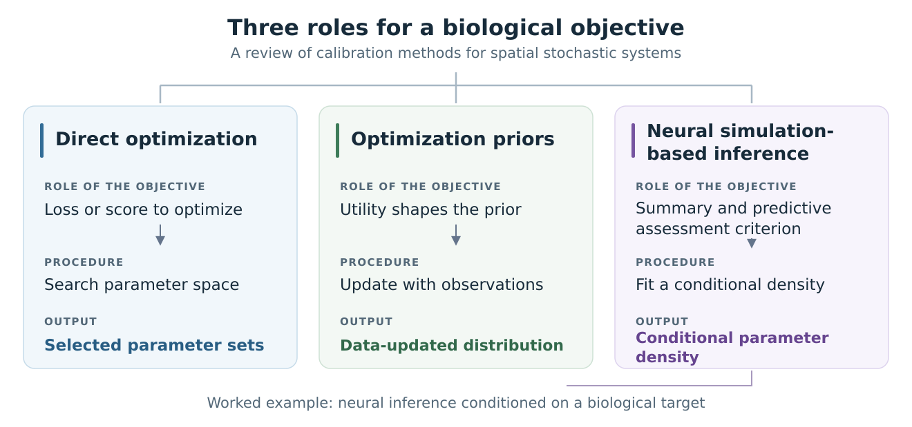
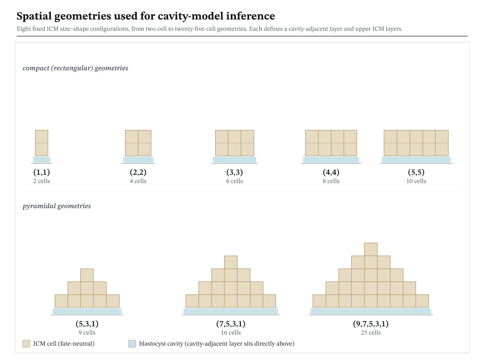

# Bridging Optimization and AI

**Parameterizing Spatial Stochastic Systems**

Michael Alexander Ramirez Sierra and Thomas R. Sokolowski

*Scientific software accompanying the European Journal of Applied Mathematics manuscript*

How can a biological objective guide parameter inference when the underlying
model is spatial, stochastic and expensive to simulate? The paper reviews
direct optimization, optimization priors and neural simulation-based inference,
and connects the different roles an objective can play in those approaches.



*Conceptual overview of the three strategies reviewed in the paper. The
biological example below illustrates the neural approach.*

This repository develops the reproducible worked example: a spatial stochastic
model of early embryonic cell-fate specification, calibrated with neural
simulation-based inference. It extends the
[published ICM model](https://doi.org/10.1371/journal.pcbi.1012473) with the
cavity formulation developed in the
[doctoral thesis](https://doi.org/10.21248/gups.92001).

## The biological example

NANOG/GATA6 regulation and intercellular FGF4 signaling couple cells arranged
around a blastocyst cavity. Stochastic reaction and transport events generate
cell-fate patterns across **eight fixed ICM geometries**.



*Illustrative geometries used in the cavity-model example, from the paper’s supplement. [Vector PDF](figures/model_geometries.pdf).*

One parameter vector is evaluated under two conditions:

- **Fgf4 knockout:** the biological target is EPI throughout the ICM.
- **Wild type:** the target combines cavity-adjacent PRE with upper-layer EPI.

A time-resolved pattern score measures agreement with both targets. A separate
ensemble meta-score selects candidate parameterizations. Predictive checks ask
whether the inferred parameters produce the intended biology; calibration
checks assess uncertainty in the fitted parameter distribution.

## Start here

The [reader guide](docs/START_HERE.md) explains the repository, expected outputs
and compute needs. Start by rebuilding the supplied numerical results; then
choose whether to generate data, train models or run new diagnostics.

## Quick start: reproduce the supplied results

From this source checkout, using Python 3.8 on Linux:

```bash
git clone https://github.com/MARS-FIAS/bridging-optimization-and-ai.git
cd bridging-optimization-and-ai
python3.8 -m venv .venv
source .venv/bin/activate
python -m pip install -c environments/constraints-python38.txt '.[plots]'
python -m cavity_sbi reproduce --output-dir outputs/reproduction
python -m cavity_sbi reproduce --output-dir outputs/reproduction --execute
```

This rebuilds reference plots and CSV/JSON summaries from compact evidence,
without loading a neural network or generating simulations. The first command
previews; the second writes into a new output directory. The
[paper reproduction map](docs/REPRODUCTION_MAP.md) links panels to inputs and
commands. For the full simulation/neural workflow, install the
[pinned CPU environment](environments/README.md), then preview the first stage:

```bash
python -m cavity_sbi generate --geometry 5_3_1 --round 0 --run-dir outputs/5_3_1
```

The `generate`, `train` and `select` commands preview by default and require
`--execute` to run. The [workflow guide](docs/workflow.md) covers paper/small
profiles, CPU workers, restartable outputs and sequential selection.
The [diagnostic guide](docs/diagnostics.md) provides separate commands for
selected-MAP evaluation, density-wide prediction and frozen-estimator marginal
SBC. Each previews by default; reports can be rebuilt from saved results without
running a simulator or loading a neural network.

The [configuration glossary](docs/CONFIGURATION.md) explains biological symbols,
parameter units and file settings. The [installation checks](docs/VALIDATION.md)
provide one command for verifying either environment after installation.

## Data access and reproduction scope

The catalogued training tensors alone occupy **290.02 GB
(290,018,317,172 bytes)**; full training and testing datasets are available from
the authors on request and are omitted here because of their substantial size.
[Data-access details](docs/data_access.md) give the inventory scope and contact.

The repository supplies code, configurations and **eight final neural estimators
(3.70 MB total)**. Compact derived evidence supports numerical checks and figure
reconstruction. Large training, validation,
testing and calibration simulation banks, raw molecular trajectories and complete
posterior-draw banks are excluded; generation commands recreate them in
user-selected data directories.

Reproduction targets ensemble behavior and scientific conclusions across
stochastic runs. Seeds are supplied where available; identical individual
trajectories or retrained network weights are not required.

## Repository contents

| Location | Contents |
| --- | --- |
| [`src/cavity_sbi/`](src/cavity_sbi/) | Portable simulation, fitting, diagnostics and numerical reproduction |
| [`config/`](config/) | Parameter bounds, biological targets, time grids and eight geometries |
| [`artifacts/`](artifacts/) | Eight final estimators with a checksum and configuration manifest |
| [`environments/`](environments/) | Pinned CPU environment and installation instructions |
| [`docs/`](docs/) | Scientific interfaces, reproduction scope and data access |
| [`evidence/`](evidence/) | Compact numerical inputs, source hashes and storage-size records |
| [`Script_Bank/`](Script_Bank/) | Reference listings documenting the research implementation |

## Citation and contributors

Please cite the accompanying paper when using these materials.
[CITATION.cff](CITATION.cff) provides author and project metadata.
The model's doctoral-thesis context is available through
[doi:10.21248/gups.92001](https://doi.org/10.21248/gups.92001).

The authors direct the scientific decisions and retain responsibility for the
code, numerical results and conclusions. ChatGPT/Codex assisted code inspection,
analysis, verification, writing and repository preparation; Claude assists figure
development. The manuscript documents AI assistance. Licensing is recorded in
[LICENSE_STATUS.md](LICENSE_STATUS.md); source/dependency notices are in
[NOTICE.md](NOTICE.md). See [CHANGELOG.md](CHANGELOG.md) for the software scope.
